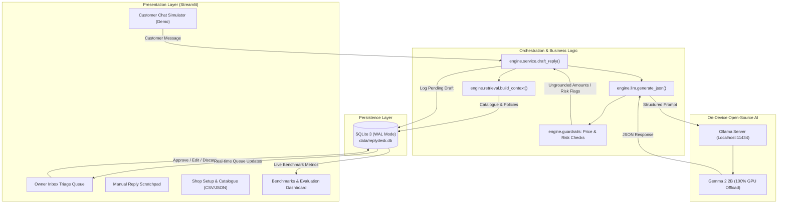

# ReplyDesk: Local AI Customer-Reply Assistant for Small Sellers

> **DEV / MLH Hacktoberfest 2026 Open-Source AI Challenge (Week 2: "Side Hustle")**  
> Built with open-weight **Gemma 4 Effective 2B** and **Gemma 2 2B**, running locally on-device with zero cloud APIs, zero per-reply subscription bills, and complete customer privacy.

[](LICENSE)
[](https://www.python.org/downloads/)
[](https://ollama.com)
[](https://ai.google.dev/gemma)
[]()
[]()

---

## The Problem

Small independent merchants running boutique shops on Instagram and WhatsApp (apparel, home bakeries, handmade jewellery) spend 3 to 5 hours every single day answering repetitive buyer inquiries:
- *"Kitne ka hai?"* (Price check)
- *"Is size XL available in blue?"* (Variant and stock check)
- *"Can you deliver to Pune in 2 days?"* (Delivery policy)
- *"What is your return policy?"* (Return window)

Delayed replies directly cause abandoned carts and lost sales. Many buyers inquire in a mix of Hindi, Marathi, and Hinglish. Small sellers often reply in a rush with inaccurate numbers or inconsistent details. Generic cloud chatbots hallucinate non-existent discounts, invent uncatalogued inventory, and send private customer data to third-party servers.

---

## What is ReplyDesk?

**ReplyDesk** is a retrieval-grounded assistant designed specifically for small Indian social sellers. The seller configures their shop once (products, variants, prices in INR, policies, tone, few-shot style examples). When a customer inquiry arrives, ReplyDesk drafts an accurate, polite reply in the buyer's language and script (English, Hindi, Marathi, or Hinglish) using **only the seller's actual catalogue and policy data**.

Everything executes on the merchant's local laptop using Ollama and Gemma 2 2B. **Nothing is ever sent automatically**: the merchant reviews the draft in an inbox triage queue, makes edits if needed, and approves it with a single click.

---

## Architecture Overview

ReplyDesk uses **retrieval-grounded generation**: the active shop catalogue, policies, and few-shot style examples are injected directly into a structured prompt context. No embeddings, no external vector databases, and no cloud dependencies.



---

## Key Features

1. **Split-Screen Interactive Demo Mode:**
   - Left window: **Owner Inbox Triage** queue showing pending customer inquiries, editable AI drafts, grounding warnings, and 1-click review actions (*Send as is*, *Send edited*, *Discard*).
   - Right window: **Simulated Customer Messenger** simulating WhatsApp customer chat on localhost without requiring third-party API accounts.

2. **Context-Injected Grounding:**
   - Active catalogue items, prices, and policies are injected into the prompt context.
   - If an inquiry asks for uncatalogued details (e.g., custom tailoring), the prompt instructs the model to state the shop will check and flags the card with a `needs_check` warning.

3. **Precompiled Guardrails:**
   - **Numeric Grounding:** Extracts all currency values (e.g. `₹899`, `Rs. 1,200`, `1499/-`, and Devanagari numerals `₹१,२००`) and verifies they belong to the shop's known catalogue.
   - **Risk Topic Alerts:** Precompiled word-boundary regexes detect sensitive inquiries (allergies, health, discount bargaining, wholesale requests, private contact numbers) without false positives (e.g. "office" or "coffee" do not trigger false discount flags).

4. **Multi-Tenant Shop Isolation:**
   - Switch between sample shops (*Urban Thread* apparel, *Sweet Crumbs* bakery, *Kalakruti Jewels* artisanal jewellery) or custom shops with one click.
   - Database queries are strictly partitioned by `seller_id`; replies for one shop never leak data from another.

5. **Flexible Catalogue Management:**
   - Add items individually via form or upload bulk inventory via standard CSV.
   - Export and import full shop profiles as portable JSON configs.

6. **Automated Evaluation Suite & Live Dashboard:**
   - Built-in benchmark runner ([eval/run_eval.py](file:///d:/HackFest_W2/replydesk/eval/run_eval.py)) evaluates 34 standardized customer test cases across 4 languages (21 dev cases, 13 test cases).
   - Dedicated Streamlit dashboard with top KPI tiles, performance slices (All, English, Hindi, Marathi, Hinglish, dev, test), diagnostic failure inspector, and markdown report downloads.

7. **SQLite FTS5 Smart Hybrid Retrieval & RRF:**
   - Full-text search over `products(name, category, description, notes)` powered by SQLite's native FTS5 engine with BM25 relevance ranking.
   - Reciprocal Rank Fusion (RRF) combines FTS5 BM25 search with pure-Python cosine vector similarity over local embeddings, falling back gracefully when offline.
   - Real-time triggers (`AFTER INSERT`, `AFTER UPDATE`, `AFTER DELETE`) keep the search index synchronized with zero maintenance.
   - Live FTS5 keyword filter directly embedded in the Catalogue manager UI.

8. **Enterprise Privacy & Security Guardrails:**
   - **PII Scrubbing:** Automatically redacts credit cards, Aadhaar numbers, phone numbers, and emails before prompt construction.
   - **Prompt Injection Defense:** Scans for jailbreak patterns and untrusted instruction overrides. Quarantines inputs with `<untrusted_customer_message>` boundary containment and triggers safe human escalation refusals.
   - **Numeric Policy Verification:** Verifies both product prices and policy thresholds (e.g. minimum order amounts for free delivery) against known database values.
   - **SSRF Protection:** Enforces localhost-only inference endpoint binding (`127.0.0.1` / `localhost`) to block SSRF and cloud data leaks.

9. **Interactive Reviewer Tools:**
   - **Reply Tone Switcher:** On-the-fly persona selection (*Warm Boutique*, *Concise WhatsApp*, *Polite Hinglish*) directly in the reply scratchpad.
   - **Live Telemetry Bar:** Real-time visibility into routed model tier, actual model execution, prompt and completion token counts, and generation latency.
   - **1-Click FAQ Saving:** Automatically persist frequently asked customer questions and approved answers into shop policies directly from the owner triage queue.

---

## Hardware Tested & System Telemetry

ReplyDesk was built, benchmarked, and verified on a mid-range laptop:
- **Processor:** Intel Core i5 12th Gen (i5-12450H)
- **Graphics:** NVIDIA GeForce RTX 3050 Laptop GPU (6 GB VRAM)
- **RAM:** 16 GB DDR4
- **Ollama Models Benchmarked:**
  - `gemma4:e2b` (Flagship): 4.6 GB footprint, **100% GPU offload**, ~6.4s median latency
  - `gemma2:2b` (Fast): 1.9 GB footprint, **100% GPU offload**, ~3.4s median latency
  - `gemma2:9b`: 7.1 GB footprint, 54% GPU / 46% CPU offload, ~12.4s median latency
  - `gemma:7b`: 7.8 GB footprint, 54% GPU / 46% CPU offload, ~11.8s median latency

---

## Quickstart Guide

### 1. Prerequisites
- Python 3.11 or higher
- [Ollama](https://ollama.com/) installed and running locally

### 2. Setup Ollama & Download Models
Open a terminal and start Ollama, then pull the recommended models:
```bash
ollama serve

# Flagship model (94.1% pass rate, 4.6 GB Q4_K_M):
ollama pull gemma4:e2b

# Fast lightweight baseline (85.3% pass rate, 1.6 GB):
ollama pull gemma2:2b
```

### 3. Clone Repository & Install Dependencies
```bash
git clone https://github.com/<your-username>/replydesk.git
cd replydesk
pip install -r requirements.txt
```

### 4. Initialize Database with Sample Shops
```bash
python -m engine.db init
python -m engine.importer config/urban_thread.json --replace
python -m engine.importer config/sweet_crumbs.json --replace
python -m engine.importer config/kalakruti_jewels.json --replace
```

### 5. Launch the Application
```bash
streamlit run app.py
```
Open your browser at `http://localhost:8501`.

---

## Running the Automated Benchmark Suite

ReplyDesk includes an automated evaluation harness with 34 test cases in [eval/questions.json](eval/questions.json) (21 dev split, 13 frozen test split).

To run the complete benchmark suite from the command line:
```bash
python -m eval.run_eval --split all --model gemma4:e2b
```

Or view and execute benchmarks interactively in the Streamlit UI under the **"📊 Benchmarks & Eval"** navigation tab.

### Running Unit Tests
```bash
pytest -v
```
All **43 unit tests pass** in ~13 seconds with 100% offline integrity.

---

## Multi-Model Comparative Benchmark Matrix

Comprehensive evaluation across 4 local model generations on NVIDIA RTX 3050 (6GB VRAM):

| Model Tag | Architecture | Quant / Size | VRAM / Offload | Overall Pass | Facts Accuracy | Safety (needs_check) | Devanagari Preservation | Median Latency |
|---|---|---|---|---|---|---|---|---|
| **gemma4:e2b** | Gemma 4 Effective 2B | Q4_K_M (4.6 GB) | **100% GPU** | **94.1% (32/34)** | **97.1% (33/34)** | **100.0% (34/34)** | **100.0% (15/15)** | 6,389 ms |
| **gemma2:2b** | Gemma 2 2B | Q4_0 (1.6 GB) | **100% GPU** | **85.3% (29/34)** | **94.1% (32/34)** | 88.2% (30/34) | 93.3% (14/15) | 3,440 ms |
| **gemma2:9b** | Gemma 2 9B | Q4_0 (5.4 GB) | 54% GPU / 46% CPU | **72.0% (18/25)** | 92.0% (23/25) | 100.0% (25/25) | 25.0% (1/4) | 12,395 ms |
| **gemma:7b** | Gemma 1 7B | Q4_0 (5.0 GB) | 54% GPU / 46% CPU | **52.0% (13/25)** | 76.0% (19/25) | 80.0% (20/25) | 66.7% (4/6) | 11,767 ms |

### Flagship Performance: Gemma 4 Effective 2B (34 Cases)

From the standardized evaluation run on 34 cases ([eval/reports/eval_gemma4_e2b_20261015_194915.md](eval/reports/eval_gemma4_e2b_20261015_194915.md)):

| Slice | Cases | facts_ok | needs_check_ok | language_ok | Overall Pass | Median Latency |
|---|---|---|---|---|---|---|
| **All Cases** | 34 | 33/34 (97.1%) | 34/34 (100.0%) | 33/34 (97.1%) | **32/34 (94.1%)** | 6,389 ms |
| **English** | 13 | 13/13 (100.0%) | 13/13 (100.0%) | 12/13 (92.3%) | **12/13 (92.3%)** | 6,136 ms |
| **Hindi** | 8 | 8/8 (100.0%) | 8/8 (100.0%) | 8/8 (100.0%) | **8/8 (100.0%)** | 6,417 ms |
| **Marathi** | 7 | 7/7 (100.0%) | 7/7 (100.0%) | 7/7 (100.0%) | **7/7 (100.0%)** | 6,929 ms |
| **Hinglish** | 6 | 5/6 (83.3%) | 6/6 (100.0%) | 6/6 (100.0%) | **5/6 (83.3%)** | 6,187 ms |
| **dev Split** | 21 | 20/21 (95.2%) | 21/21 (100.0%) | 21/21 (100.0%) | **20/21 (95.2%)** | 6,394 ms |
| **test Split** | 13 | 13/13 (100.0%) | 13/13 (100.0%) | 12/13 (92.3%) | **12/13 (92.3%)** | 6,236 ms |

### Fast Baseline Performance: Gemma 2 2B (34 Cases)

From the standardized evaluation run on 34 cases ([eval/reports/eval_gemma2_2b_20261014_221253.md](eval/reports/eval_gemma2_2b_20261014_221253.md)):

| Slice | Cases | facts_ok | needs_check_ok | language_ok | Overall Pass | Median Latency |
|---|---|---|---|---|---|---|
| **All Cases** | 34 | 32/34 (94.1%) | 30/34 (88.2%) | 33/34 (97.1%) | **29/34 (85.3%)** | 3,440 ms |
| **English** | 13 | 12/13 (92.3%) | 12/13 (92.3%) | 13/13 (100.0%) | **11/13 (84.6%)** | 3,463 ms |
| **Hindi** | 8 | 8/8 (100.0%) | 7/8 (87.5%) | 8/8 (100.0%) | **7/8 (87.5%)** | 3,421 ms |
| **Marathi** | 7 | 6/7 (85.7%) | 6/7 (85.7%) | 6/7 (85.7%) | **6/7 (85.7%)** | 3,627 ms |
| **Hinglish** | 6 | 6/6 (100.0%) | 5/6 (83.3%) | 6/6 (100.0%) | **5/6 (83.3%)** | 3,380 ms |
| **dev Split** | 21 | 20/21 (95.2%) | 19/21 (90.5%) | 20/21 (95.2%) | **19/21 (90.5%)** | 3,438 ms |
| **test Split** | 13 | 12/13 (92.3%) | 11/13 (84.6%) | 13/13 (100.0%) | **10/13 (76.9%)** | 3,452 ms |

---

## Why Open Innovation Matters

| Dimension | Cloud API Approach (e.g. Closed Model) | ReplyDesk (Local Gemma 2 2B + Ollama) |
|---|---|---|
| **Customer Privacy** | Customer chats and internal margins sent to 3rd-party servers | **On-Device:** Data stays on the seller's computer |
| **Operating Cost** | $0.25 to $0.50 per 1M tokens (~₹0.20 per customer inquiry) | **Electricity Only:** ~₹0.001 per reply (~₹10 for 10,000 replies) |
| **Offline Reliability** | Dependent on active internet connection and API uptime | **Zero Internet Required:** Verified working completely offline with Wi-Fi disconnected |
| **Vendor Lock-in** | Proprietary APIs, forced model deprecations, price changes | **Open Weights:** Swappable model tag in `.env` with no code changes |

---

## Known Failure Modes and Benchmark Caveats

Honest disclosure of model behavior and benchmark limitations observed during testing:

1. **SC-16 (Delivery Fee Omission):** For Sweet Crumbs, when asked about delivery for a ₹650 cake to Baner, the model stated delivery is free for orders of ₹800 or above, but omitted the applicable ₹50 delivery charge.
2. **UT-04 (Fallback Script Mismatch):** When asked in Marathi about size exchange policy, the model occasionally defaults to the English safe fallback ("We'll check this and get back to you shortly.") rather than reciting the 7-day exchange window in Marathi.
3. **Conservative Over-Checking (UT-05, SC-11):** The model sometimes marks `needs_check: true` for out-of-stock items or standard custom requests (like eggless cakes), treating them with extra caution even when catalogue policies state standard availability.
4. **Keyword Scoring Limitations:** The evaluation harness scores replies using keyword and regex matching. It verifies known prices and key terms, but cannot detect invented factual statements other than prices if they are not covered by explicit negative checks.
5. **Run-to-Run Variance:** Because generation runs with standard sampling (temperature 0.3), results vary slightly between runs without prompt changes.
6. **Review-First Workflow:** Drafts are suggestions. A human seller must review every draft before sending it to a customer.
7. **Demo Messaging:** The Customer Chat page is a local simulation for split-screen demonstration purposes; it is not hooked into official WhatsApp Business Cloud APIs (which require paid enterprise verification).

---

## Roadmap & Future Upgrades

See [docs/FUTURE_UPGRADES.md](docs/FUTURE_UPGRADES.md) for detailed technical specifications on post-hackathon enhancements:
- **Confidence-Gated Auto-Dispatch:** Opt-in Auto-Pilot mode that automatically sends high-confidence FAQ replies while holding ambiguous or policy queries for owner review.
- **Dynamic Bargaining & Negotiation Engine:** Merchant-configured floor prices and pre-approved discount boundaries.
- **Sentiment & Emotion-Aware Triage:** Inbox sorting prioritizing angry or high-intent purchase queries.
- **Direct Messaging Webhooks:** Official WhatsApp Cloud API and Instagram Graph API connectors.
- **Multimodal Voice & Image Grounding:** Local Whisper transcription for customer voice notes and vision-based catalogue search.

---

## License

This project is licensed under the [Apache License 2.0](LICENSE).

Open-weight Gemma models are distributed under the [Google Gemma Terms of Use](https://ai.google.dev/gemma/terms).

