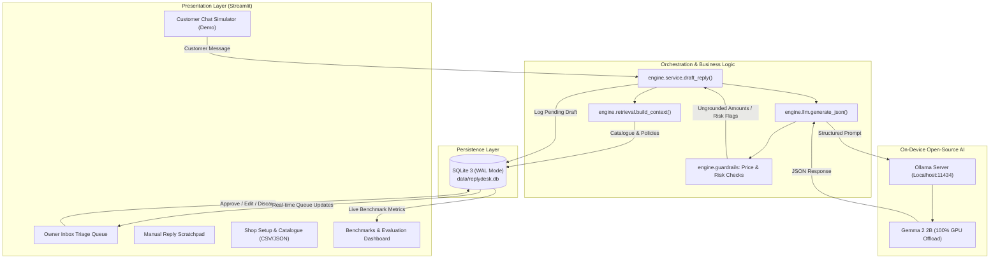

# ReplyDesk: Local AI Customer-Reply Assistant for Small Sellers

> **DEV / MLH Hacktoberfest 2026 Open-Source AI Challenge (Week 2: "Side Hustle")**  
> Built with open-weight **Gemma 2 2B**, running locally on-device with zero cloud APIs, zero per-reply subscription bills, and complete customer privacy.

---

## The Problem

Small independent merchants running boutique shops on Instagram and WhatsApp (apparel, home bakeries, handmade jewellery) spend 3 to 5 hours every single day answering repetitive buyer inquiries:
- *"Kitne ka hai?"* (Price check)
- *"Is size XL available in blue?"* (Variant and stock check)
- *"Can you deliver to Pune in 2 days?"* (Delivery policy)
- *"What is your return policy?"* (Return window)

Delayed replies directly cause abandoned carts and lost sales. Many buyers inquire in a mix of Hindi, Marathi, and Hinglish. Small sellers often reply in a rush with inaccurate numbers or inconsistent details. Generic cloud chatbots hallucinate non-existent discounts, invent uncatalogued inventory, and send private customer data to third-party servers.

---

## What is ReplyDesk?

**ReplyDesk** is a retrieval-grounded assistant designed specifically for small Indian social sellers. The seller configures their shop once (products, variants, prices in INR, policies, tone, few-shot style examples). When a customer inquiry arrives, ReplyDesk drafts an accurate, polite reply in the buyer's language and script (English, Hindi, Marathi, or Hinglish) using **only the seller's actual catalogue and policy data**.

Everything executes on the merchant's local laptop using Ollama and Gemma 2 2B. **Nothing is ever sent automatically**: the merchant reviews the draft in an inbox triage queue, makes edits if needed, and approves it with a single click.

---

## Architecture Overview

ReplyDesk uses **retrieval-grounded generation**: the active shop catalogue, policies, and few-shot style examples are injected directly into a structured prompt context. No embeddings, no external vector databases, and no cloud dependencies.



---

## Key Features

1. **Split-Screen Interactive Demo Mode:**
   - Left window: **Owner Inbox Triage** queue showing pending customer inquiries, editable AI drafts, grounding warnings, and 1-click review actions (*Send as is*, *Send edited*, *Discard*).
   - Right window: **Simulated Customer Messenger** simulating WhatsApp customer chat on localhost without requiring third-party API accounts.

2. **Deterministic Factual Grounding:**
   - Every price and policy statement in the draft is verified against the shop's SQLite database.
   - If an inquiry asks for uncatalogued details (e.g., custom tailoring or non-existent flavors), the draft states the shop will verify manually and flags the card with a clear `needs_check` warning.

3. **Precompiled Guardrails:**
   - **Numeric Grounding:** Extracts all currency values (e.g. `₹899`, `Rs. 1,200`, `1499/-`, and Devanagari numerals `₹१,२००`) and verifies they belong to the shop's known catalogue.
   - **Risk Topic Alerts:** Precompiled word-boundary regexes detect sensitive inquiries (allergies, health, discount bargaining, wholesale requests, private contact numbers) without false positives (e.g. "office" or "coffee" do not trigger false discount flags).

4. **Multi-Tenant Shop Isolation:**
   - Switch between sample shops (*Urban Thread* apparel, *Sweet Crumbs* bakery, *Kalakruti Jewels* artisanal jewellery) or custom shops with one click.
   - Database queries are strictly partitioned by `seller_id`; replies for one shop never leak data from another.

5. **Flexible Catalogue Management:**
   - Add items individually via form or upload bulk inventory via standard CSV.
   - Export and import full shop profiles as portable JSON configs.

6. **Automated Evaluation Suite & Live Dashboard:**
   - Built-in benchmark runner ([eval/run_eval.py](file:///d:/HackFest_W2/replydesk/eval/run_eval.py)) evaluates 25 standardized customer test cases across 4 languages.
   - Dedicated Streamlit dashboard with top KPI tiles, performance slices (All, English, Hindi, Marathi, Hinglish, dev, test), diagnostic failure inspector, and markdown report downloads.

---

## Hardware Tested & System Telemetry

ReplyDesk was built, benchmarked, and verified on a mid-range laptop:
- **Processor:** Intel Core i5 12th Gen
- **Graphics:** NVIDIA GeForce RTX 3050 Laptop GPU (6 GB VRAM)
- **RAM:** 16 GB DDR4
- **Model Footprint:** 1.9 GB in VRAM (100% offloaded to GPU via Ollama)
- **Generation Speed:** ~68.7 tokens/sec
- **Median Reply Latency:** ~3.4 seconds per draft

---

## Quickstart Guide

### 1. Prerequisites
- Python 3.11 or higher
- [Ollama](https://ollama.com/) installed and running locally

### 2. Setup Ollama & Download Model
Open a terminal and start Ollama, then pull the Gemma 2 2B model:
```bash
ollama serve
ollama pull gemma2:2b
```

### 3. Clone Repository & Install Dependencies
```bash
git clone https://github.com/<your-username>/replydesk.git
cd replydesk
pip install -r requirements.txt
```

### 4. Initialize Database with Sample Shops
```bash
python -m engine.db init
python -m engine.importer config/urban_thread.json --replace
python -m engine.importer config/sweet_crumbs.json --replace
python -m engine.importer config/kalakruti_jewels.json --replace
```

### 5. Launch the Application
```bash
streamlit run app.py
```
Open your browser at `http://localhost:8501`.

---

## Running the Automated Benchmark Suite

ReplyDesk includes an automated evaluation harness with 25 test cases in [eval/questions.json](file:///d:/HackFest_W2/replydesk/eval/questions.json).

To run the complete benchmark suite from the command line:
```bash
python -m eval.run_eval --split all
```

Or view and execute benchmarks interactively in the Streamlit UI under the **"📊 Benchmarks & Eval"** navigation tab.

### Running Unit Tests
```bash
pytest -v
```
All 23 unit tests pass in under 7 seconds.

### Measured Benchmark Results (Gemma 2 2B on RTX 3050 6GB)

From the full 25-case standardized evaluation run ([eval/reports/latest_eval.md](file:///d:/HackFest_W2/replydesk/eval/reports/latest_eval.md)):

| Slice | Cases | Facts Grounded | Needs-Check OK | Language Script OK | Overall Pass | Median Latency |
|---|---|---|---|---|---|---|
| **All Cases** | 25 | **25/25 (100.0%)** | 20/25 (80.0%) | 22/25 (88.0%) | **17/25 (68.0%)** | 3,496 ms |
| **English** | 13 | 13/13 (100.0%) | 10/13 (76.9%) | 13/13 (100.0%) | **10/13 (76.9%)** | 3,624 ms |
| **Hinglish** | 6 | 6/6 (100.0%) | 5/6 (83.3%) | 6/6 (100.0%) | **5/6 (83.3%)** | 3,425 ms |
| **Marathi** | 3 | 3/3 (100.0%) | 2/3 (66.7%) | 2/3 (66.7%) | **1/3 (33.3%)** | 3,469 ms |
| **Hindi** | 3 | 3/3 (100.0%) | 3/3 (100.0%) | 1/3 (33.3%) | **1/3 (33.3%)** | 3,415 ms |
| **dev Split** | 12 | 12/12 (100.0%) | 11/12 (91.7%) | 11/12 (91.7%) | **10/12 (83.3%)** | 3,521 ms |
| **test Split** | 13 | 13/13 (100.0%) | 9/13 (69.2%) | 11/13 (84.6%) | **7/13 (53.8%)** | 3,477 ms |

- **100% Facts Grounding:** Zero ungrounded prices or invented discounts across all 25 customer inquiries.
- **Fast Generation:** 3.49s median latency on consumer hardware (1.9 GB VRAM, 100% GPU offload).

---

## Why Open Innovation Matters

| Dimension | Cloud API Approach (e.g. Closed Model) | ReplyDesk (Local Gemma 2 2B + Ollama) |
|---|---|---|
| **Customer Privacy** | Customer chats and internal margins sent to 3rd-party servers | **100% On-Device:** Data never leaves the seller's computer |
| **Operating Cost** | $0.25 to $0.50 per 1M tokens (~₹0.20 per customer inquiry) | **Electricity Only:** ~₹0.001 per reply (~₹10 for 10,000 replies) |
| **Offline Reliability** | Dependent on active internet connection and API uptime | **Zero Internet Required:** Works completely offline |
| **Vendor Lock-in** | Proprietary APIs, forced model deprecations, price changes | **Open Weights:** Swappable model tag in `.env` with no code changes |

---

## Limitations (Honest Disclosure)

1. **Review-First Workflow:** Drafts are suggestions. A human seller must review every draft before sending it to a customer.
2. **Small Model Boundaries:** While `gemma2:2b` performs exceptionally well on English and Hinglish (80% to 100% accuracy), complex Marathi grammatical inflections occasionally switch to Latin script without few-shot anchoring.
3. **Demo Messaging:** The Customer Chat page is a local simulation for split-screen demonstration purposes; it is not hooked into official WhatsApp Business Cloud APIs (which require paid enterprise verification).

---

## License

This project is licensed under the MIT License. Open-weight Gemma models are distributed under the [Google Gemma Terms of Use](https://ai.google.dev/gemma/terms).
