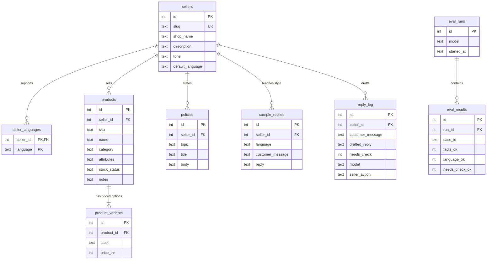

# Database design (DBMS) - ReplyDesk

Engine: SQLite 3 (Python standard library `sqlite3`). One file per installation (`data/replydesk.db`). The authoritative DDL is `db/schema.sql`; this document explains it. If they disagree, fix them together and add a migration note below.

## 1. Why SQLite

- Local single-user app: no server to install, one file to back up.
- ACID transactions, foreign keys, CHECK constraints, views, triggers, and optional FTS5 full-text search.
- Python ships with it. Fewer moving parts on a 5-day timeline.
- Alternatives (PostgreSQL, MongoDB) add setup and a running service without helping a single local user. They only make sense for the hosted, multi-seller version described as future work in `SYSTEM_DESIGN.md`.

Always run `PRAGMA foreign_keys = ON;` on every connection (SQLite does not enforce foreign keys by default). `engine/db.py::connect` does this.

## 2. Entities and relationships



## 3. Tables

| Table | Purpose | Key constraints |
|---|---|---|
| `sellers` | One row per shop | `slug` UNIQUE; `default_language` CHECK in (`en`,`hi`,`mr`,`hinglish`) |
| `seller_languages` | Languages a shop wants to reply in | PK (`seller_id`, `language`); CHECK on language |
| `products` | A catalogue item | UNIQUE (`seller_id`, `sku`); `stock_status` CHECK; `attributes` must be valid JSON |
| `product_variants` | Priced options of a product (size, weight, pack) | UNIQUE (`product_id`, `label`); `price_inr` integer >= 0 |
| `policies` | Delivery, returns, payment, hours, ordering, other | `topic` CHECK; UNIQUE (`seller_id`, `topic`, `title`) |
| `sample_replies` | Examples of the seller's own style, used as few-shot | `language` CHECK |
| `reply_log` | Every draft, flags, and what the seller did | `seller_action` CHECK in (`sent_as_is`,`edited`,`discarded`) or NULL |
| `eval_runs` | One row per evaluation run | |
| `eval_results` | One row per test case per run | UNIQUE (`run_id`, `case_id`) |

All child tables use `ON DELETE CASCADE` from their parent, so deleting a seller removes their products, policies, samples, and history in one statement.

Prices are stored as whole rupees (`INTEGER`), not floats, to avoid rounding issues. If paise are ever needed, store paise.

`attributes` is a JSON text column on `products` holding optional lists such as `{"sizes": ["S","M"], "colors": ["Blue"]}`. It is deliberately not normalized further: attributes vary by shop type (sizes for clothes, flavours for cake), the app only reads them to print into the prompt, and no queries filter on them. This is a conscious trade-off against a fully normalized EAV design.

Timestamps are ISO-8601 text in UTC (`datetime('now')`).

## 4. Normalization

- 1NF: every column is atomic, except the intentional JSON `attributes` column explained above.
- 2NF/3NF: prices live in `product_variants`, not repeated on `products`; shop-level facts (tone, languages) live on `sellers` and `seller_languages`; no non-key column depends on another non-key column. A product's category is a plain text attribute; if categories ever needed their own properties they would move to a `categories` table.
- `reply_log.customer_message` and `drafted_reply` are intentionally denormalized snapshots: they must not change if a product price changes later, so history stays an accurate record of what was drafted.

## 5. Indexes

| Index | Reason |
|---|---|
| `idx_products_seller` on `products(seller_id)` | Load a shop's catalogue |
| `idx_variants_product` on `product_variants(product_id)` | Join variants to products |
| `idx_policies_seller` on `policies(seller_id)` | Load a shop's policies |
| `idx_samples_seller` on `sample_replies(seller_id, language)` | Pick few-shot examples |
| `idx_reply_log_seller_time` on `reply_log(seller_id, created_at DESC)` | History page, newest first |
| `idx_eval_results_run` on `eval_results(run_id)` | Summaries per run |

The UNIQUE constraints also create indexes. Data volumes are small (tens of products, hundreds of log rows), so indexes are about correctness of lookups and good habits, not heavy performance tuning.

## 6. View

`v_catalog` joins sellers, products, and variants into one row per priced option. The retrieval module and the grounding check read from it.

## 7. Transactions

- Importing a shop (`import_config`) runs in a single transaction: either the whole shop is stored or nothing is. With `replace=True`, delete-then-insert happens in the same transaction.
- Logging a draft is one `INSERT`. Updating the seller's action is one `UPDATE` by primary key.
- Use `with conn:` in Python so commit/rollback is automatic.

## 8. Example queries

All use parameters (`?`), never string formatting.

Catalogue for a shop:
```sql
SELECT sku, product_name, variant_label, price_inr, stock_status
FROM v_catalog
WHERE seller_slug = ?
ORDER BY sku, price_inr;
```

Every price the reply may legitimately mention (feeds the grounding check):
```sql
SELECT DISTINCT price_inr
FROM v_catalog
WHERE seller_slug = ?;
```

Products that are low in stock or out of stock:
```sql
SELECT sku, product_name, stock_status
FROM v_catalog
WHERE seller_slug = ? AND stock_status IN ('low_stock', 'out_of_stock')
GROUP BY sku;
```

How often drafts were flagged, and what sellers did with them:
```sql
SELECT seller_action, COUNT(*) AS drafts, SUM(needs_check) AS flagged
FROM reply_log
WHERE seller_id = ?
GROUP BY seller_action;
```

Evaluation summary per run and language:
```sql
SELECT r.id AS run_id, r.model, e.language,
       COUNT(*) AS cases,
       SUM(e.facts_ok) AS facts_ok,
       SUM(e.language_ok) AS language_ok,
       SUM(e.needs_check_ok) AS needs_check_ok,
       ROUND(AVG(e.latency_ms)) AS avg_latency_ms
FROM eval_runs r
JOIN eval_results e ON e.run_id = r.id
GROUP BY r.id, e.language
ORDER BY r.id, e.language;
```
(Median latency is computed in Python; SQLite has no built-in median.)

### 8.1. `reply_log` as a Demo Message Queue

For the demo's simulated customer chat and owner inbox, `reply_log` doubles as an asynchronous message queue without schema changes:
- Incoming customer messages are inserted with `seller_action = NULL` (pending review).
- The customer UI tracks its own message IDs in memory (`st.session_state`) and polls their status.
- The owner inbox queries pending drafts, presents them for review/editing, and updates `seller_action` to `'sent_as_is'`, `'edited'`, or `'discarded'`.

Fetch pending drafts for owner inbox:
```sql
SELECT id, customer_message, drafted_reply, needs_check, check_reason,
       ungrounded_amounts, risk_topics, model, latency_ms, created_at
FROM reply_log
WHERE seller_id = ? AND seller_action IS NULL
ORDER BY created_at DESC;
```

Resolve a draft (Send or Discard):
```sql
UPDATE reply_log
SET seller_action = ?, final_reply = ?
WHERE id = ?;
```

Customer chat polling for a tracked message:
```sql
SELECT id, customer_message, drafted_reply, final_reply, seller_action, created_at
FROM reply_log
WHERE id = ?;
```

## 9. Optional full-text search (stretch)

If a catalogue grows past the prompt budget, add an FTS5 index over `products(name, description)` in `db/fts.sql` with triggers to keep it in sync, and retrieve the top-k products for a message. FTS5 must be available in the installed SQLite build; check with `PRAGMA compile_options;`. Not part of the core schema so the core never fails on a build without FTS5.

## 10. Migrations

- Schema version is stored in `PRAGMA user_version`. `schema.sql` sets it to 1.
- `init_db` applies `schema.sql` only when `user_version = 0`.
- To change the schema: write a numbered migration script, bump `user_version`, update this document, and update `docs/CONFIG_SCHEMA.md` if the config format changes. Ask the user first (see `AGENTS.md`).

## 11. Backup, export, and deletion

- Backup: copy the `.db` file, or export each shop to JSON with `export_config` (human-readable, version-controllable).
- Delete history: `DELETE FROM reply_log WHERE seller_id = ?` (exposed as "Clear history").
- Delete a shop: `DELETE FROM sellers WHERE id = ?`; cascades remove everything under it.
- The database is not encrypted. Do not store real customer personal data in sample databases.

## 12. Constraints worth testing

- Duplicate `(seller_id, sku)` is rejected.
- Negative price is rejected.
- Invalid `stock_status`, `topic`, or `language` is rejected.
- Invalid JSON in `attributes` is rejected.
- Deleting a seller cascades to children.
- Inserting a product for a non-existent seller fails (foreign keys on).
