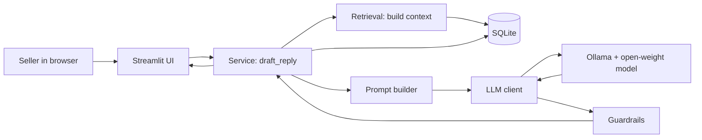
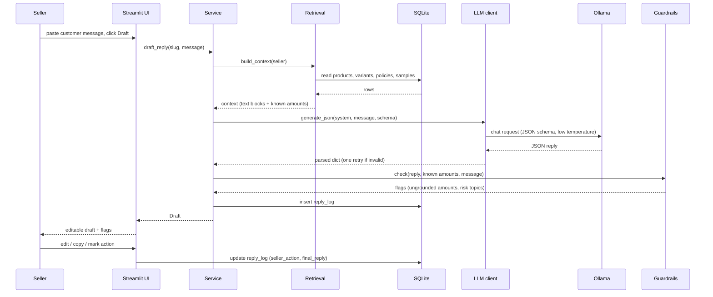
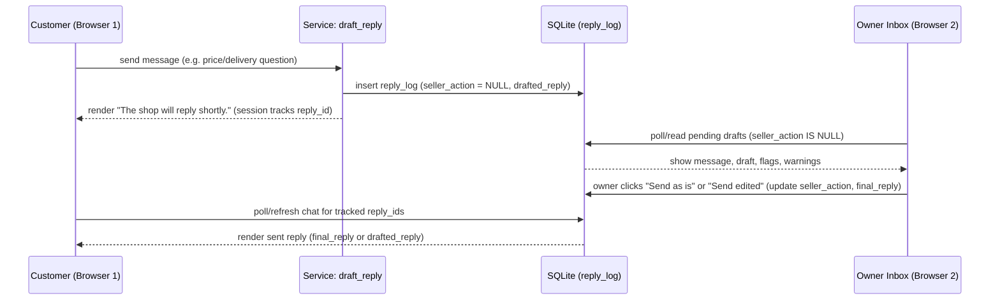

# System design - ReplyDesk

Companion docs: `PRD.md` (what), `ARCHITECTURE.md` (modules), `DBMS.md` (data), `PROMPTS.md` (model behaviour).

## 1. Context and goals

A single seller, on their own laptop, wants drafted replies to customer messages that are correct (facts only from their data), in the customer's language, private, and cheap. The system is a local web app that wraps a local open-weight model.

Design priorities, in order:
1. Correctness of facts (a wrong price is worse than a slow reply)
2. Privacy and offline operation
3. Simplicity (5-day build)
4. Speed on a 6 GB GPU laptop
5. Extensibility to other shops without code changes

### Terminology
ReplyDesk is a **retrieval-grounded generation** tool. In v1 the retrieval step is straightforward: the seller's whole catalogue and policies are compiled into the prompt (no embeddings, no vector database). SQLite FTS5 keyword search is an optional stretch goal for larger catalogues. Do not describe ReplyDesk as a vector-search RAG system anywhere in documentation, code comments, or UI text.

## 2. Requirements

### Functional
See `PRD.md` user stories US1 to US8: set up a shop, draft a reply, review and log, switch shops (login-free isolation), history, swap model, evaluate, and customer simulator + owner inbox.

### Non-functional

| Area | Requirement | How it is met |
|---|---|---|
| Privacy | Seller data and customer messages never leave the machine | Local Ollama, local SQLite, no external network calls |
| Offline | Works with the network off after the model is downloaded | No cloud dependencies at runtime |
| Latency | Acceptable on i5 12th gen + RTX 3050 6 GB. Target to be measured (set after the first benchmark) | Smallest model that passes eval, short prompts, low `num_ctx`, short outputs |
| Memory | Model plus context fits mostly in 6 GB VRAM | Small model tag, `NUM_CTX=4096`, verify with `ollama ps` |
| Correctness | No invented prices or policies | Grounded prompt, structured output, numeric grounding check, `needs_check` fallback, human review |
| Reliability | App survives Ollama down, model missing, bad model output | Typed errors, one retry on invalid JSON, clear UI messages |
| Maintainability | Swap model or add shop without code changes | `MODEL_NAME` setting, config import/export |
| Cost | Near zero per reply | Local inference; cost estimate method in `EVAL_PLAN.md` |

## 3. Constraints

- Hardware: i5 12th gen, RTX 3050 Laptop 6 GB VRAM. Larger models spill into system RAM and slow down sharply.
- Time: 14 to 18 Oct. Anything not on the task list is out.
- Models: small open-weight models are weaker in Hindi and Marathi than in English. The design must tolerate and measure this.
- Licence: Gemma has its own licence terms. Check before distributing model files.

## 4. High-level design

Everything inside the diagram runs on one machine. The only network hop is `localhost` to Ollama.

## 5. Request flow: draft a reply

### 5.2. Simulated chat & owner inbox flow (demo-only)

Limitation: This is purely a local demo simulation across two browser tabs reading the same local SQLite database. It is not connected to WhatsApp, Instagram, or any external messaging API.

## 6. Key design decisions

**D1. Local inference with Ollama.** Gives privacy, offline use, zero per-reply cost, and model swapping, which are exactly the arguments the challenge asks for. Cost: speed is limited by a laptop GPU.

**D2. SQLite for storage.** One file, no server, in the Python standard library, ACID, enough for one seller's catalogue and logs. Alternatives (Postgres, MongoDB) add setup with no benefit for a single local user.

**D3. Put the whole catalogue in the prompt for small shops; use search only if it grows.** A shop with under about 40 products fits in a few thousand tokens. Putting everything in the prompt avoids retrieval errors (the right product is always visible). If a catalogue is larger, use SQLite FTS5 keyword search for the top-k products (stretch goal). No embedding model in v1, to save VRAM and complexity.

**D4. Structured JSON output.** The model returns `{reply, language, needs_check, reason}`. This lets the UI show a needs-check flag reliably and lets the eval script score replies. Use Ollama's structured-output (`format` with a JSON schema) if the installed version supports it; otherwise instruct the model and parse, with one retry.

**D5. Draft-only, human in the loop.** The model can still be wrong. The seller reviews every reply. This is also a safety and honesty decision for the post.

**D6. SQLite is the runtime source of truth; JSON is import/export.** The setup form writes to SQLite. JSON files let a seller share, back up, and version a shop, and let us ship sample shops. There is one importer and one exporter, and a round-trip test.

**D7. Streamlit UI.** Fastest way to a usable interface in Python. Run bound to localhost.

**D8. Numeric grounding check.** After generation, extract every currency amount from the reply and verify it exists in the seller's data. Unknown amounts set `needs_check` with a reason. This is cheap and catches the most damaging failure (a wrong price). It does not verify delivery days or sizes in v1; that limitation is documented.

**D9. Risk-topic soft warning.** Messages that mention allergies, health, discounts, wholesale, or custom work get a separate "double-check before sending" banner in the UI, independent of the model's own `needs_check`.

**D10. Demo simulation using reply_log as message queue.** To demo the end-to-end user experience without building fragile unofficial WhatsApp scrapers or cloud dependencies, `reply_log` acts as a lightweight queue. `seller_action IS NULL` designates pending incoming messages. Customer browser state is isolated in memory with `st.session_state` (no user login or sessions in DB).

## 7. Capacity and performance

One user, one request at a time. No concurrency design is needed beyond serializing calls to Ollama.

Rough context budget at `NUM_CTX=4096` (estimates to be replaced by measurements):

| Part | Approx tokens |
|---|---|
| Rules and format instructions | 300 to 400 |
| Shop info and policies | 200 to 500 |
| Few-shot examples (2 to 3) | 200 to 400 |
| Catalogue (about 40 tokens per product) | up to 1,600 for 40 products |
| Customer message | 20 to 150 |
| Reply (output) | 60 to 200 |

Devanagari text uses more tokens per word than English, so Hindi and Marathi examples cost more. Keep examples few and short. Record real token counts in `BUILD_LOG.md`.

Switch from "whole catalogue in prompt" to FTS5 retrieval when the catalogue block exceeds roughly 1,500 tokens.

## 8. Failure modes

| Failure | Detection | Handling |
|---|---|---|
| Ollama not running | Connection error | UI message: start Ollama (`ollama serve`); no crash |
| Model not pulled | "model not found" from Ollama | UI message with the `ollama pull <tag>` command |
| Out of memory / very slow | Latency over a threshold, or `ollama ps` shows CPU spill | Documented in SETUP; suggest a smaller tag or lower `NUM_CTX` |
| Invalid JSON output | Parse failure | One retry; then show an error and the raw text for debugging, do not auto-use it |
| Wrong language | Eval script script-check; seller sees draft | Reported in eval; seller edits |
| Invented price | Numeric grounding check | Flag needs-check with reason |
| Prompt injection in customer message | Prompt rule 5; eval case | Rule in system prompt; eval case; seller reviews |
| Empty catalogue or no policies | Pre-check in service | UI asks seller to finish setup first |
| DB file missing or corrupt | Open fails | `init` recreates; instruct to restore from JSON export |

## 9. Security and privacy

- Local only. Run `streamlit run app.py --server.address localhost` so it is not exposed on the network.
- No telemetry. No runtime internet access needed.
- Customer messages are stored in `reply_log` on the seller's disk. Provide a "clear history" action. Do not store real customer personal data in sample data.
- Prompt injection: customer text is untrusted. The prompt tells the model to ignore instructions in it, and the output is constrained to JSON, so the worst case is a poor draft that the seller reviews.
- The database file is not encrypted. State this in the README limitations.

## 10. Observability

- Each draft logs model, latency, language, needs-check, flags, and the seller's action.
- Evaluation runs log per-case results (`eval_runs`, `eval_results`).
- `docs/BUILD_LOG.md` is the human-readable record.

## 11. Testing strategy

- Unit tests (no model): importer round-trip, config validation, retrieval formatting, guardrails (amount extraction, grounding), DB constraints.
- Integration test (needs Ollama, skipped otherwise): one draft per sample shop returns valid JSON.
- Evaluation: `eval/run_eval.py` over `eval/questions.json` per `EVAL_PLAN.md`.
- Manual: tone and Marathi/Hindi quality review; offline test; fresh-install test from the README.

## 12. Future scaling path (not built, mention only as future work)

- Hosted version: run the open-weight model on a GPU server (for example a GPU droplet) and serve many sellers. This would need accounts, per-seller isolation, and a server database (Postgres), and it weakens the "data stays local" claim.
- WhatsApp Business API integration for reading and drafting inside the chat.
- Embedding-based retrieval for large catalogues.
- Fine-tuning a small model on a seller's own past replies and on Marathi/Hindi shop conversations.
- Image input (Gemma 4 is multimodal) to draft listings from product photos.

## 13. Open questions

- Which Gemma 4 tag gives the best quality that still runs well on the 6 GB GPU? (Decided by measurement in M3.)
- Is structured output supported by the installed Ollama version and chosen model? (Verify in M1.)
- Is one real seller available for a trial? (Parallel track in `TASKS.md`.)
